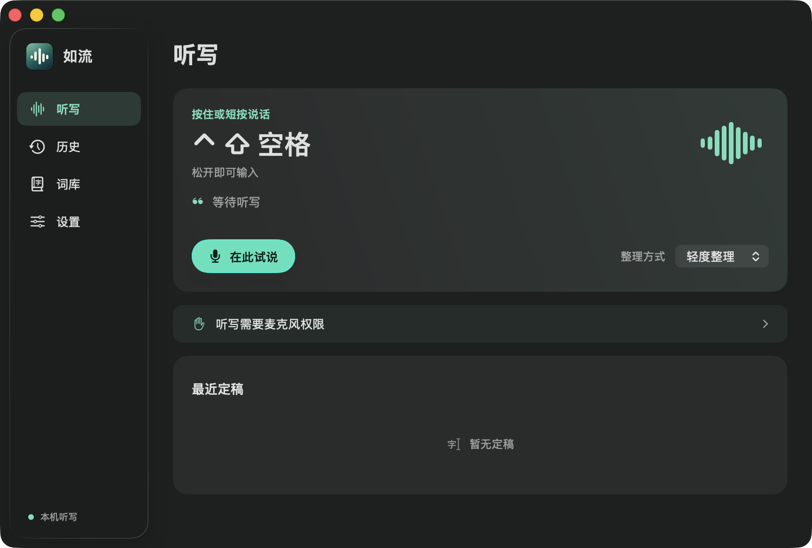
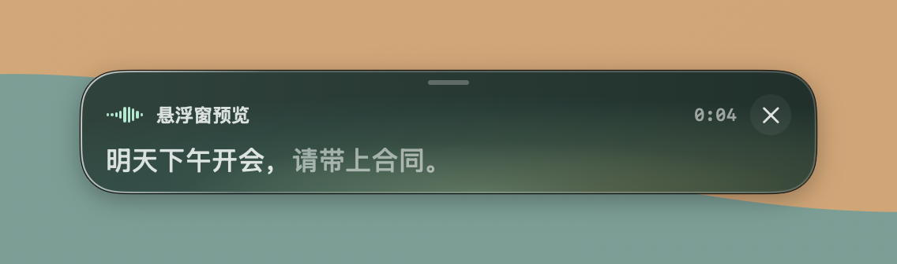
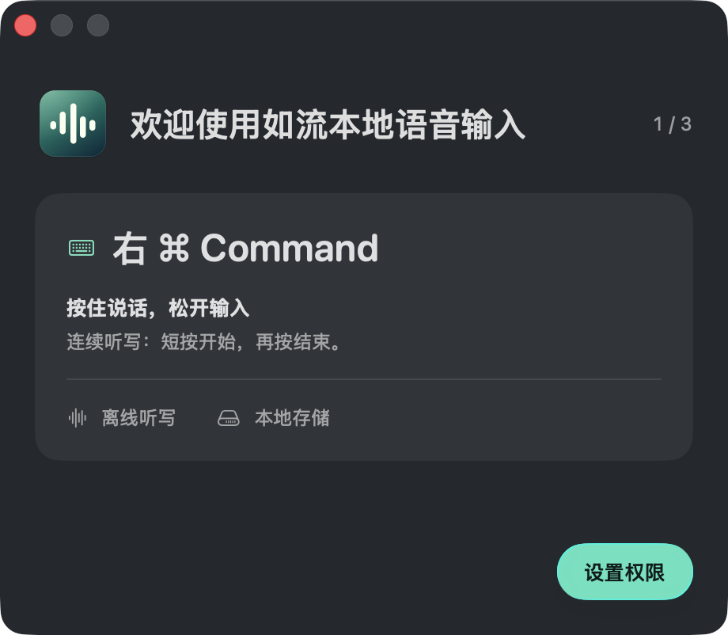
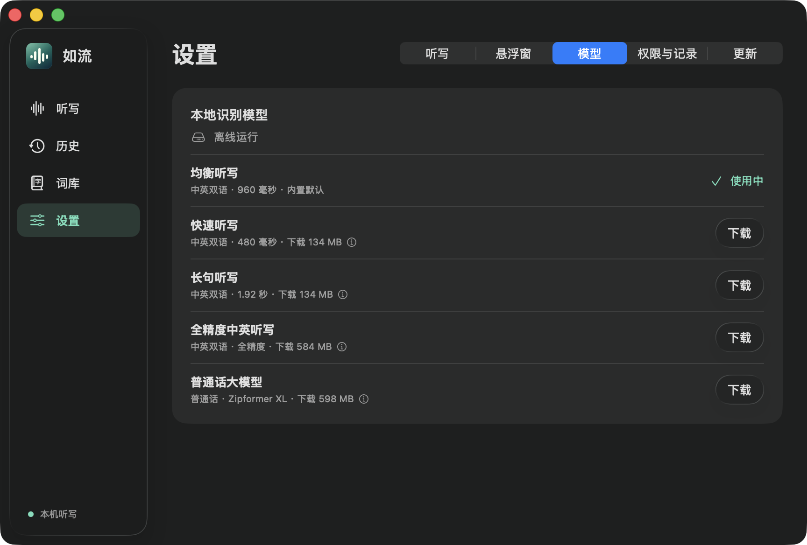

# 如流 · PhraseFlow

Mac 上的本地中英文听写。把光标放进输入框，按住**右 ⌘** 说话，松开完成听写。要连续说一段，短按开始，再按结束。不用打开主窗口。

[下载 PhraseFlow.dmg](https://github.com/BurntRoses/shengru/releases/download/v1.0.0-build.25/PhraseFlow.dmg) · [版本说明](https://github.com/BurntRoses/shengru/releases/tag/v1.0.0-build.25) · [English](#english)


## 听写与改词

- **原位输入**：在支持的输入框里，写入确认后悬浮窗直接收起。要改字，可从菜单栏打开上次听写，或编辑历史记录。
- **自动输入**：松开右 ⌘ 后，文字直接进入开始听写时的输入框；聊天内容不会自动发送。
- **长段听写**：悬浮窗正文最多两行。上翻时保持阅读位置，回到底部再跟随新字。停顿只影响标点，换话题或明确列举时才分段。
- **原声复听**：对某个词不满意？保留录音后点「增强识别」，再听一遍原声。候选写法点一下就换，不必重说整段。浮窗已收起时，可从菜单栏打开上次听写。
- **整理与词库**：四档整理从保留原话到分点行文。可导入自己的词库，也可让如流记住反复确认的改词。第一次识别不套用个人改词规则。
- **文字与录音**：各自选择是否保存、保留多少条。长录音分节写入，历史里仍是一段，可编辑或回听。

<details><summary>查看听写首页</summary>



</details>

## 悬浮窗

默认青瓷磨砂。拖动顶部横条可改变位置，松开即记住。普通桌面避开程序坞，全屏时可贴近底边。「设置 → 悬浮窗」可调整宽度、通透度、动效和停留时间，或还原位置。

| 磨砂（默认） | 液态玻璃（macOS 26+） | 不透明 |
| :---: | :---: | :---: |
|  |  |  |

<details><summary>查看外观设置</summary>


</details>

## 安装与模型

1. 打开 **PhraseFlow.dmg**，双击镜像里唯一的「如流」，点 **安装并打开**。安装完成会自动进入首次引导，无需再去访达找。支持 macOS 14 及以上，兼容 Apple 芯片和 Intel。
2. 在首次引导中设置麦克风、辅助功能、输入监控，选择是否保存文字和录音。还没允许输入监控时，可用 **Control + Shift + 空格** 听写。
3. 安装包只含「均衡听写」，首次使用不用下载。需要更快出字、更长听写窗口或更大模型时，在「设置 → 模型」点「下载」，装好后点「使用」。听写和复听均可离线进行。

| 初次引导 | 模型设置 |
| :---: | :---: |
|  |  |

**当前下载：1.0.0 候选版，尚未获 Apple 公证。** 首次打开可能出现系统提示，更新后可能需要重新授权。见 [Apple 的首次打开说明](https://support.apple.com/zh-cn/102445)。

也可以用终端安装，完成后会自动打开。已经安装时，只打开已有的如流：

```sh
git clone --depth 1 --branch v1.0.0-build.25 https://github.com/BurntRoses/shengru.git PhraseFlow
bash PhraseFlow/install.sh
```

更新时打开「设置 → 更新」查看大小、说明和进度。同一页可以卸载，选择保留或删除本机资料。手动从旧版「语音输入」升级时，只替换「应用程序」里的旧应用即可保留资料。

## English

**PhraseFlow is offline Chinese and English dictation for Mac.** Hold **Right Command** to dictate; releasing it inserts the text into the focused input field. Messages are never sent automatically. For a longer passage, tap once to start and again to finish. The menu bar and floating transcript work without the main window.

Long passages use a two-line panel; scroll up to read without losing your place. A pause alone does not start a new paragraph. Edit a finished passage from the menu bar or history. When available, replay the audio to check a word, then click a suggested spelling to apply it. The frosted panel remembers its position and can sit near the bottom edge in full screen. One balanced model is bundled; four others are optional downloads. Dictation, recordings and personal vocabulary stay on your Mac.

[Download PhraseFlow 1.0.0](https://github.com/BurntRoses/shengru/releases/download/v1.0.0-build.25/PhraseFlow.dmg). Open the disk image, double-click **如流**, then choose **安装并打开** (Install and Open). The installed app opens the first-run guide. The terminal installer also opens the app when it finishes. For macOS 14+ on Apple silicon and Intel; interface in Simplified Chinese. **This pre-release is not Apple-notarized.** See [Apple’s first-launch guidance](https://support.apple.com/en-us/102445).

[构建脚本 / Build script](源码/构建.command) · [第三方许可 / Notices](源码/Resources/Licenses)
