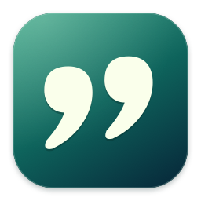
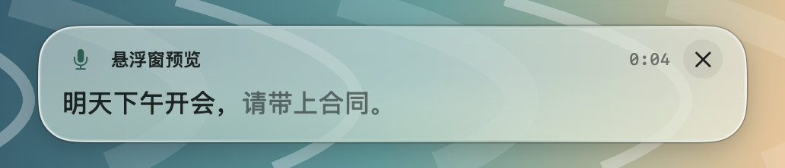
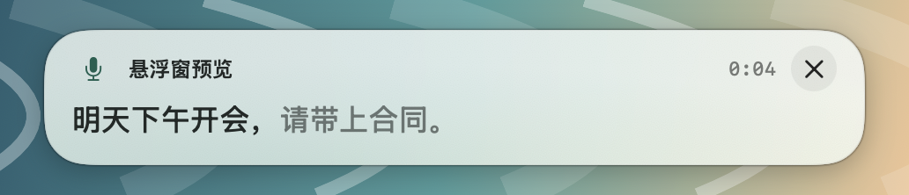
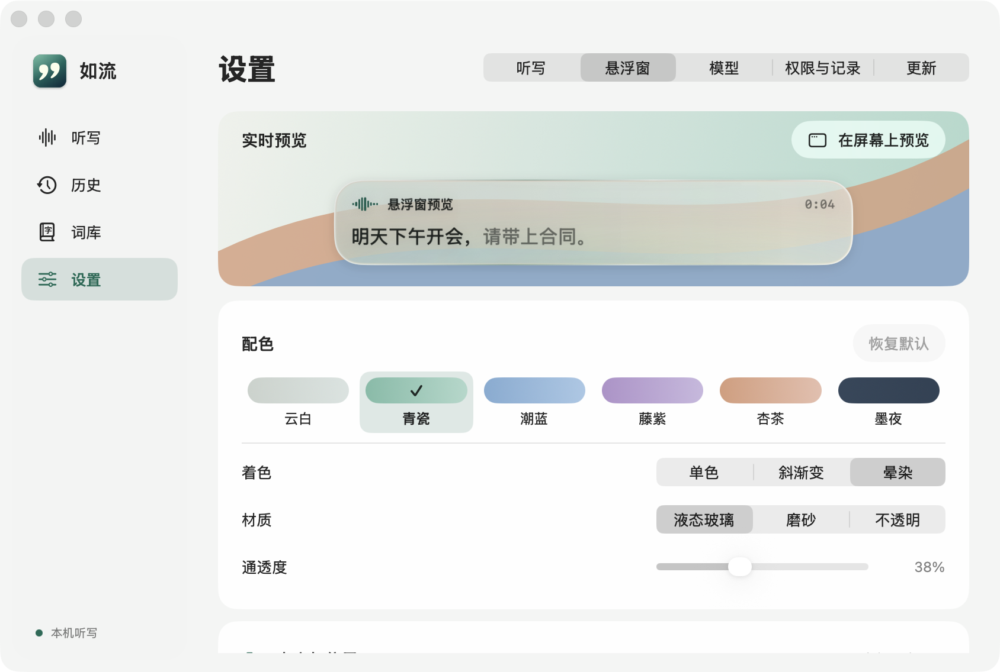

# 如流 · PhraseFlow

**把光标放好，按住右 ⌘，说完松手。** 如流把中英文口述写进你正在用的 Mac 应用。第一段听写就能断网使用，不需要账户。

[下载 macOS 安装包](https://github.com/BurntRoses/shengru/releases/download/v1.0.0-build.21/PhraseFlow.dmg) · [版本说明](https://github.com/BurntRoses/shengru/releases/tag/v1.0.0-build.21) · [English](#english) · [完整使用说明](源码/使用说明.md)


## 一段话，从开口到定稿

| 想做什么 | 怎么用 |
| --- | --- |
| 回一条消息 | 按住右 ⌘ 说话，松开写回原光标。写长一点？短按开始，再按一次结束。 |
| 改刚才说的一句 | 直接点悬浮窗或听写页里的文字修改，⌘↩ 保存。原文和选区仍吻合时才写回；已经移开光标，就保留修改稿供复制。 |
| 分清一个同音词 | 保留录音后点「增强识别」，对照原声复听。有合适的可选写法，点一下就能替换。 |
| 日常用自己的术语 | 可导入词表，也可以从已确认的改词中积累记忆。首次识别先听原声，校对才参考语境；一处改动不会成为全局替换。 |
| 只留下想留的内容 | 文字、录音、词库和记忆都在本机。文字与录音可分别关闭、限量或删除。 |

## 让悬浮窗适合你的桌面

玻璃能透出桌面轮廓，磨砂把背景柔化，不透明则隔开背景。默认青瓷晕染，底部光晕缓缓移动；关闭动效或开启系统「减少动态效果」，光晕就停下。设置里能预览实际大小，再决定颜色、字号和停留时间。

| 材质 | 同一背景上的悬浮窗 |
| --- | --- |
| 液态玻璃 |  |
| 磨砂 |  |
| 不透明 |  |

<details><summary>查看外观设置</summary>



</details>

## 安装与更新

1. 下载 **PhraseFlow.dmg**，把「如流」拖入「应用程序」，或双击镜像里的应用选择「安装并打开」。支持 **macOS 14+、Apple 芯片与 Intel**；液态玻璃需要 macOS 26+。
2. 首次打开，按引导允许麦克风、辅助功能和输入监控，再选择记录偏好。没有输入监控时，可先用 **Control + Shift + 空格**。
3. 如流启动时在后台检查新版。设置里可看大小、更新内容和进度，选择安装、稍后再说或忽略该版。卸载入口在「设置 → 更新」，可选择是否同时删掉本机资料。

**当前下载是 1.0.0 修订 21 候选版，未经 Apple 公证。** 首次打开可能受到系统拦截；请核对下载来源并参阅 [Apple 的说明](https://support.apple.com/zh-cn/102445)。此候选版升级后可能需要重新授权。

用终端安装（需要 Git）：

```sh
git clone --depth 1 --branch v1.0.0-build.21 https://github.com/BurntRoses/shengru.git PhraseFlow
bash PhraseFlow/install.sh
```

## English

**PhraseFlow is local Chinese and English dictation for Mac.** Place your cursor, hold **Right Command**, speak, and release to type. For a longer passage, tap once to start and again to finish. The last finished passage stays beneath the live transcript.

Click a word in the floating panel, workspace or history to edit it. Save with **⌘↩**. PhraseFlow checks the original text and selection before replacing a passage in another app. You can replay the recording, choose a different spelling, and import your own vocabulary. Your speech, text and corrections stay on your Mac. Only update checks, software updates and optional model downloads use the network.

[Download for macOS](https://github.com/BurntRoses/shengru/releases/download/v1.0.0-build.21/PhraseFlow.dmg). Install in Applications and follow the first-run guide. Runs on macOS 14 or later; Apple silicon and Intel are supported. The interface is in Simplified Chinese. **This candidate is not notarized by Apple.** See [Apple’s first-launch guidance](https://support.apple.com/en-us/102445). System permissions may need to be granted again after updating this candidate.

[构建 / Build](源码/使用说明.md#从源码构建) · [第三方许可 / Third-party notices](源码/Resources/Licenses)
